# 반도체 칩 속 공기 빈틈은 크기보다 위치가 더 중요하다

**TIM 보이드 열 예측** — 빈틈이 반도체 칩 온도를 얼마나 올리는지 바로 알려주는 웹 도구 (열 계산 + AI)

이희석 · 상명대학교 전자공학과 2학년 · 천안형 AX 액션러닝 개인 프로젝트 (2026.09 ~ 11)

<!-- 배포 주소: Streamlit Community Cloud 에 올린 뒤 여기에 링크를 넣는다 -->

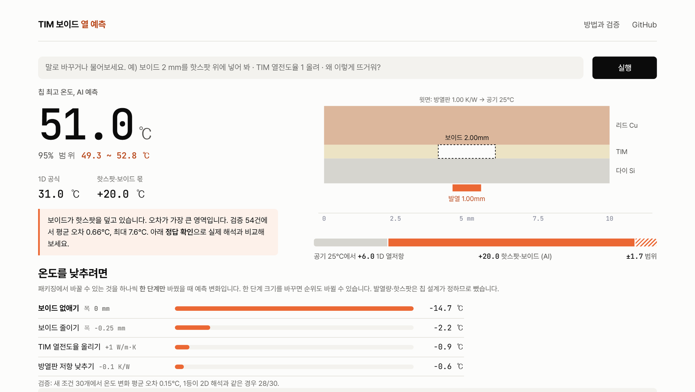
*웹 도구 첫 화면. 폭 2 mm 빈틈이 가장 뜨거운 곳 바로 위에 있는 조건이고, AI가 예측한 반도체 칩 최고 온도는 51.0℃다.*

> **세 줄 요약**
> 1. 같은 2 mm 공기 빈틈도 **가장 뜨거운 곳 바로 위면 +14.6℃**, **2 mm만 비켜나면 +0.1℃**다. 위치에 따라 100배 넘게 차이 난다.
> 2. 정밀 계산으로 3,156가지 경우를 다 보려면 **161분**이 걸린다. AI로 **0.3초** 만에 위험 지도를 그리는 웹 도구를 만들었다.
> 3. 학습에 쓰지 않은 처음 보는 조건 160개에서 AI와 정밀 계산의 평균 차이는 **0.39℃**였다.

---

## 목차

1. [3분 만에 이해하기 — 처음 보는 분께](#1-3분-만에-이해하기--처음-보는-분께)
2. [발견 — 같은 빈틈도 위치에 따라 100배 넘게 차이](#2-발견--같은-빈틈도-위치에-따라-100배-넘게-차이)
3. [웹 도구 사용법](#3-웹-도구-사용법)
4. [어떻게 만들었나](#4-어떻게-만들었나)
5. [믿을 수 있나 — 검증](#5-믿을-수-있나--검증)
6. [이미 있는 연구와 무엇이 다른가](#6-이미-있는-연구와-무엇이-다른가)
7. [한계](#7-한계)
8. [직접 실행하기](#8-직접-실행하기)
9. [폴더와 문서 안내](#9-폴더와-문서-안내)
10. [연구 과정 상세 기록](#10-연구-과정-상세-기록)

---

## 1. 3분 만에 이해하기 — 처음 보는 분께

### 반도체 칩은 왜 식혀야 하나

반도체 칩은 일할수록 열이 난다. 뜨거워지면 **느려지고**, 오래 쓰면 **빨리 고장 난다**.
그래서 열을 바깥으로 잘 빼내는 구조가 반도체 칩만큼 중요하다.

열은 반도체 칩 전체에서 고르게 나지 않는다. 계산을 많이 하는 곳에 몰려서 **가장 뜨거운 곳(핫스팟)** 이 생긴다.
고장은 평균 온도가 아니라 이 가장 뜨거운 곳에서 먼저 난다.

### 열이 나가는 길

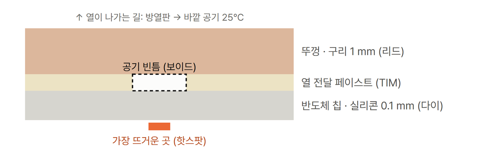
*반도체 칩 단면 (두께는 보기 좋게 과장). 열은 아래 반도체 칩에서 위 뚜껑과 방열판을 거쳐 바깥 공기로 나간다.*

| 쉬운 이름 | 전문 용어 | 하는 일 | 이 프로젝트의 기본값 |
|---|---|---|---|
| 반도체 칩 | 다이 (die) | 열이 나는 곳 | 실리콘 0.1 mm, 10 × 10 mm |
| 가장 뜨거운 곳 | 핫스팟 (hotspot) | 열이 몰려 나는 곳 | 가운데 1 mm, 총 5 W |
| 열 전달 페이스트 | TIM (열 전달 물질) | 반도체 칩과 뚜껑 사이 틈을 메워 열을 전한다. 컴퓨터 CPU에 바르는 서멀 구리스와 같은 역할 | 0.05 mm, 열전도율 3 W/m·K |
| 뚜껑 | 리드 (lid) | 열을 넓게 퍼뜨린다 | 구리 1 mm |
| 방열판 | heat sink | 열을 공기로 넘긴다 | 열저항 1 K/W, 공기 25℃ |

### 무엇이 문제인가 — 공기 빈틈(보이드)

반도체 칩과 뚜껑을 붙이는 공정에서 열 전달 페이스트 안에 **공기 빈틈(보이드, void)** 이 갇히는 불량이 생긴다.
공기는 열을 거의 못 전한다. 열 전달 페이스트(3 W/m·K)의 약 **1/115** 수준(0.026 W/m·K)이라, 빈틈은 열이 지나는 길을 막는 벽이 된다.

### 그런데 지금 방식으로는 알기 어렵다

1. **정밀 계산은 느리다.** 빈틈 하나의 영향을 정밀하게 계산(2D 열해석)하는 데 1회 약 3초가 걸린다. 빈틈 위치·크기 3,156가지를 다 보려면 **약 161분**이다.
2. **업계 검사 기준은 면적만 본다.** 예를 들어 미국 군용 규격 MIL-STD-883의 반도체 칩 접합 X선 검사 기준은 빈틈이 **얼마나 큰지**만 보고, **어디에 있는지**는 보지 않는다.

**그래서 만들었다:** 빈틈이 *어디에* 있을 때 위험한지를 **빠르고, 믿을 수 있게** 알려주는 도구.

---

## 2. 발견 — 같은 빈틈도 위치에 따라 100배 넘게 차이

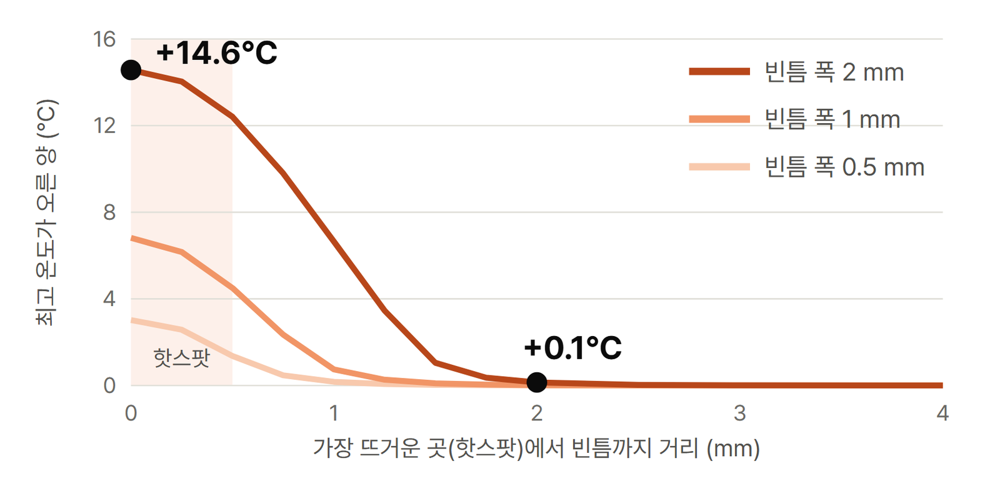
*가로: 가장 뜨거운 곳에서 빈틈까지 거리. 세로: 빈틈 때문에 최고 온도가 오른 양. 같은 5 W 반도체 칩.*

| 빈틈 폭 | 가장 뜨거운 곳 바로 위 | 2 mm 옆 | 4 mm 옆 |
|---|---:|---:|---:|
| 0.5 mm | +3.0℃ | 0.0℃ | 0.0℃ |
| 1 mm | +6.8℃ | 0.0℃ | 0.0℃ |
| **2 mm** | **+14.6℃** | **+0.1℃** | 0.0℃ |

**왜 이렇게 차이 날까?** 반도체 칩이 0.1 mm로 얇아서, 가장 뜨거운 곳에서 난 열은 옆으로 퍼질 틈 없이 **바로 위로 몰려** 나간다.
그 길을 막으면 열이 멀리 돌아가야 해서 온도가 크게 오른다. 옆을 막으면 원래 열이 별로 지나가지 않던 곳이라 거의 영향이 없다.

> 비유하면 **차가 몰리는 차선을 막느냐, 빈 차선을 막느냐**의 차이다. 면적만 보는 기준은 이 둘을 구분하지 못한다.

손으로 대략 계산해 보면, 가장 뜨거운 곳 바로 위 1 mm 폭의 페이스트를 위로 지나는 열저항은 약 1.7 K/W다.
반면 얇은 반도체 칩을 따라 옆으로 2 mm 돌아가는 열저항은 약 13 K/W로, 약 8배 험한 길이다.

이 경향(빈틈은 열원에 가까울수록 위험하다)은 다이 접합·솔더 분야에서 2000년대부터 알려져 있다. 이 프로젝트는 그것을 **TIM과 핫스팟 조건에서 다시 확인**하고, 도구로 만든 것이다 ([6절](#6-이미-있는-연구와-무엇이-다른가)).

---

## 3. 웹 도구 사용법

### 화면 구성

맨 위부터 이렇게 생겼다 ([첫 화면 그림](#반도체-칩-속-공기-빈틈은-크기보다-위치가-더-중요하다)).

| 위치 | 무엇 | 쓰인 AI |
|---|---|---|
| 맨 위 입력창 | "보이드 2 mm를 핫스팟 위에 넣어 봐"처럼 **말로 조건을 바꾸거나 물어본다** | 생성형 AI (LLM) |
| 큰 숫자 | AI가 예측한 반도체 칩 최고 온도와 **95% 범위**("95% 확률로 이 사이"). 범위가 넓으면 "자신 없음" 경고 | 머신러닝 |
| 오른쪽 단면도 | 지금 조건의 빈틈·가장 뜨거운 곳 위치, 온도가 어디서 왔는지(공식 몫 + AI 몫) | |
| 온도를 낮추려면 | 무엇을 바꾸면 온도가 가장 많이 내려가는지 **순위** | 설명 가능한 AI |
| 조건 패널 | 발열, 핫스팟 폭, 페이스트 두께·열전도율, 방열판 저항, 빈틈 폭·위치 슬라이더 | |
| 아래 보기 5개 | 정답 확인 · 보이드 위험 지도 · 허용 보이드 크기 · 규격 vs 실제 · 검증과 방법 | |

### 해 보기 1 — 빈틈을 옮겨 보기

1. 조건 패널에서 **TIM 보이드 넣기**를 켠다
2. **보이드 위치**를 5(가장 뜨거운 곳 중심)로 두면 온도가 크게 오르고, 빨간 경고가 뜬다
3. 위치를 2~3으로 옮기면 온도가 거의 원래대로 돌아온다

### 해 보기 2 — 정답 확인

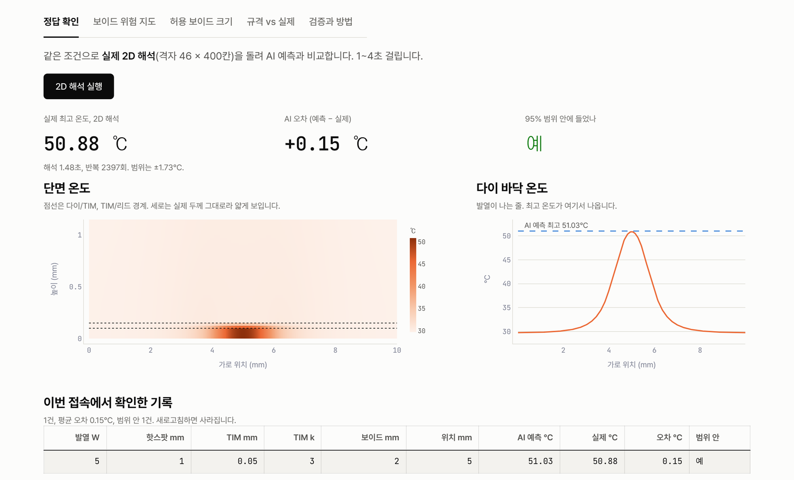
*정답 확인: 버튼 하나로 같은 조건을 정밀 계산(2D 해석)해 AI 답과 비교한다. 이 조건에서 실제 50.88℃, AI 오차 +0.15℃, 95% 범위 안.*

**2D 해석 실행**을 누르면 1~4초 뒤 실제 정밀 계산 결과가 나온다. AI 예측과 얼마나 다른지, 95% 범위 안에 들었는지 보여주고, 확인한 기록을 표로 쌓는다.

### 해 보기 3 — 보이드 위험 지도

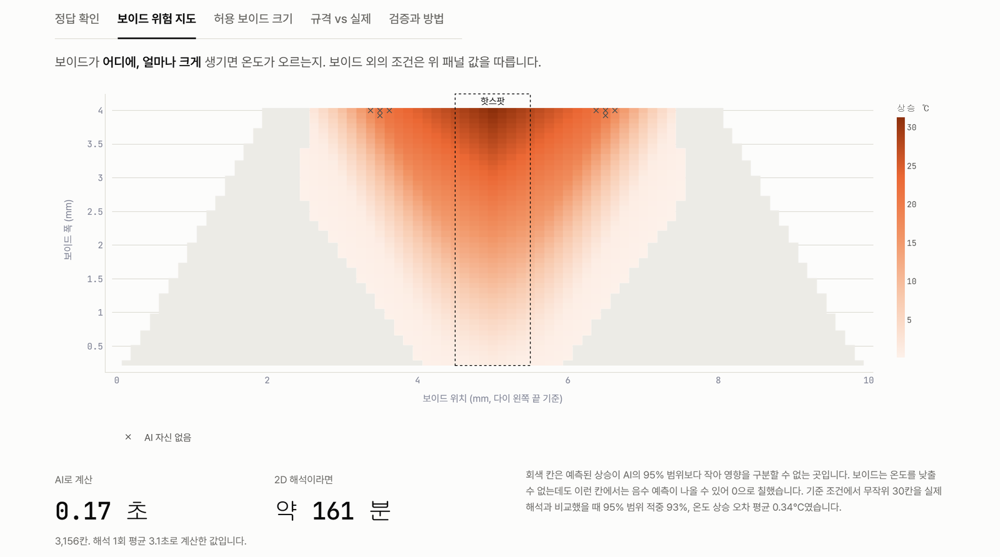
*보이드 위험 지도. 가로: 빈틈 위치, 세로: 빈틈 폭, 색: 온도가 오른 양. 진한 색이 가장 뜨거운 곳(점선 상자) 위에 몰려 있다.*

빈틈 위치 × 폭 **3,156가지**를 AI가 0.3초 안팎에 계산해 지도로 그린다. 같은 지도를 정밀 계산으로 그리면 약 161분이 걸린다.
회색 칸은 빈틈 영향이 AI의 95% 범위보다 작아 구분할 수 없는 곳이고, × 표시는 AI가 자신 없는 칸이다.

### 해 보기 4 — 규격 vs 실제

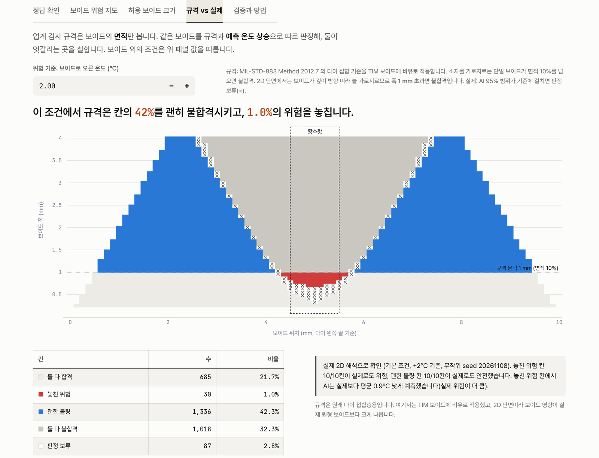
*규격 vs 실제. 파랑: 규격은 불합격인데 실제로는 안전(괜한 불량). 빨강: 규격은 합격인데 실제로는 위험(놓친 위험).*

같은 빈틈을 **업계 규격**(면적 기준)과 **실제 온도 상승**으로 따로 판정해, 둘이 엇갈리는 곳을 칠한다.

- 규격: 2D 단면에서는 빈틈이 앞뒤로 긴 띠라 항상 "가로지르는" 빈틈이다. MIL-STD-883 Method 2012.7의 "가로지르는 단일 보이드 10% 초과" 규칙을 빌려 **폭 1 mm 초과면 불합격**으로 둔다 (원래 다이 접합용 규칙을 비유로 적용)
- 실제: AI 예측 온도 상승이 **+2℃ 초과면 위험**. 95% 범위가 +2℃에 걸치면 "판정 보류"
- 기본 조건 결과: 괜한 불량 **42%**, 놓친 위험 **1%**. 놓친 위험은 가장 뜨거운 곳 바로 위의 0.7~0.95 mm 빈틈(1 mm 문턱 바로 아래)이다
- 무작위 10칸씩 정밀 계산으로 확인: 놓친 위험 10/10이 실제로도 위험, 괜한 불량 10/10이 실제로도 안전
- 이 %는 지도 칸(3,156칸)의 비율이지 **실제 공장 불량률이 아니다**

### 나머지 보기

- **허용 보이드 크기**: 온도 한계(예: 45℃)를 넣으면 넘지 않는 가장 큰 빈틈 폭을 거꾸로 구한다. 95% 범위의 위쪽 끝을 기준으로 보수적으로 답한다
- **검증과 방법**: 아래 5절의 검증 결과, 딥러닝 비교, 민감도 분석, LLM 채점표

### 주소로 조건 넣기

주소 뒤에 조건을 붙이면 그 조건으로 열린다. 예: `?void_mm=2&void_center_mm=5`
(쓸 수 있는 이름: `q_w`, `spot_mm`, `tim_mm`, `tim_k`, `r_sink`, `void_mm`, `void_center_mm`)

---

## 4. 어떻게 만들었나

```
 ① 간단한 공식 (1D 열저항)          ← 평균 온도. 계산 비용 0
 ② 정밀 계산기 (2D 유한차분)        ← 정답지. 1회 약 3초. 논문 해석해로 검증
          │  조건을 무작위로 바꿔 800번 계산
          ▼
 ③ 데이터 800건 (학습 640 / 채점 160)
          │
          ▼
 ④ AI (가우시안 과정) = ① 공식 + 공식이 놓친 차이만 학습   ← 0.001초
          │
          ▼
 ⑤ 웹 도구 (예측 · 95% 범위 · 위험 지도 · 온도 낮추기 · 말로 조건 바꾸기)
```

### ① 간단한 공식 — 1D 열저항

층을 차례로 지나가는 열을 전기 회로처럼 계산한다. **온도차 = 열 × 열저항** (전압 = 전류 × 저항과 같은 꼴).

| 층 | 두께 | 열전도율 [W/m·K] | 열저항 [K/W] |
|---|---:|---:|---:|
| 반도체 칩 (실리콘) | 0.10 mm | 150 | 0.0067 |
| 열 전달 페이스트 (TIM) | 0.05 mm | 3 | 0.1667 |
| 뚜껑 (구리) | 1.00 mm | 400 | 0.0250 |
| 방열판 → 공기 | — | — | 1.0 |
| **합계** | | | **1.198** |

5 W × 1.198 K/W ≈ 6℃ → 공기 25℃ + 6℃ = **31.0℃**. 패키지 안만 보면 가장 얇은 페이스트가 열저항의 84%를 차지하는 병목이다.

이 공식은 열이 고르게 퍼진다고 보기 때문에 **평균 온도만** 알 수 있다. 가장 뜨거운 곳과 빈틈은 볼 수 없다.

### ② 정밀 계산기 — 2D 유한차분 해석

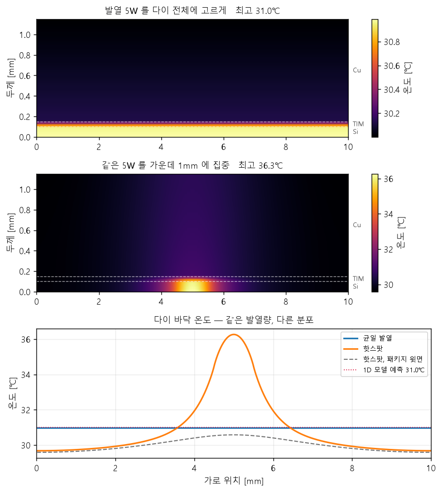
*같은 5 W를 고르게 낼 때(위)와 가운데 1 mm에 몰아 낼 때(가운데). 평균은 31.0℃로 같지만, 몰리면 최고 온도가 36.3℃로 5.3℃ 더 높다. 1D 공식은 이 차이를 볼 수 없다.*

반도체 칩 단면을 **46 × 400칸**(한 칸 0.025 mm)으로 나누고, 칸마다 "들어온 열 = 나간 열"이 되도록 온도를 반복해서 맞춘다.
빈틈은 페이스트 층의 칸 일부를 공기로 바꿔 넣는다. 이 계산기를 **정답지**로 삼았다 (검증은 5절).

### ③ 데이터 800건

발열, 핫스팟 폭, 페이스트 두께·열전도율, 방열판 저항, 빈틈 폭·위치 7가지 조건을 무작위로 바꿔 정밀 계산을 800번 돌렸다 (약 40분, 시드 42).
**학습 640건과 채점 160건을 처음부터 나눠 두고**, 채점용은 학습에 쓰지 않았다.

| 조건 (학습 범위) | 범위 |
|---|---|
| 발열 | 1 ~ 15 W |
| 핫스팟 폭 | 0.25 ~ 10 mm |
| 페이스트 두께 | 0.05 ~ 0.25 mm |
| 페이스트 열전도율 | 1 ~ 10 W/m·K |
| 방열판 저항 | 0.3 ~ 3 K/W |
| 빈틈 폭 | 0.25 ~ 4 mm (또는 없음) |

이 범위 밖은 예측하지 않고 거절한다.

### ④ AI — "공식 + AI"

AI가 온도를 처음부터 다 배우게 하지 않았다. **① 공식이 평균을 계산하고, AI는 공식이 놓친 차이(가장 뜨거운 곳·빈틈 효과)만 배운다.**
배울 것이 줄어 적은 데이터로도 정확해진다.

- AI 방법: **가우시안 과정 회귀** (numpy로 직접 구현). 데이터가 적을 때 잘 되고, 예측과 함께 "얼마나 자신 있는지"를 준다
- 빈틈이 가장 뜨거운 곳을 **얼마나 덮는지**(덮인 비율, 겹친 길이, 떨어진 거리)를 따로 계산해 AI 입력에 넣었다 (v2). 평균 오차가 1.08 → 0.39℃로 줄었다
- **95% 범위**: AI가 주는 기본 범위는 실제로는 40%만 맞았다. 학습 데이터 안의 교차검증으로 배수를 맞춰 보정했다

### AI 4종을 다 넣지 않고, 재 보고 골랐다

| 종류 | 무엇 | 측정 결과 | 썼나 |
|---|---|---|---|
| 머신러닝 | 가우시안 과정 + 1D 공식 | 새 조건 160개 평균 오차 **0.39℃** | **씀** — 예측과 95% 범위 |
| 딥러닝 | 신경망 (은닉층 3개 × 64) + 1D 공식 | **0.44℃**. 공식 없이 신경망만 쓰면 0.99℃ (2.3배 나쁨) | **안 씀** — 아래 설명 |
| 설명 가능한 AI | 순열 중요도, 한 단계씩 바꿔 보기 | "무엇을 바꾸면 가장 시원해지나" 1등 추천이 정밀 계산과 **28/30** 일치 (변화량 오차 0.15℃) | **씀** — 온도를 낮추려면 |
| 생성형 AI | LLM 에이전트 (Claude Haiku, 계산 도구 호출) | 말로 내린 명령 **10/10**, 질문 답하기 **20/20**, 계산 없이 지어낸 숫자 **0개** | **씀** — 말로 조건 바꾸기 |

- **딥러닝을 뺀 이유**: 정확도는 비슷했다. 신경망과 가우시안 과정의 "의견 차이"로 위험 신호를 만들어 봤지만, 같은 개수만 표시하게 맞춰 비교하니 95% 범위가 이미 짚은 위험과 같았다(15건 vs 15건). 새 정보가 없어서 메인 화면에 넣지 않았다
- **LLM이 숫자를 지어내지 않게**: LLM은 온도를 직접 말하지 않고, 위 계산 도구(AI 예측·정밀 계산·허용 보이드)를 불러 그 결과만 전한다. 학습 범위 밖 요청은 거절한다
- **민감도 분석에서 본 것**: 빈틈 폭의 중요도는 빈틈이 가장 뜨거운 곳과 겹칠 때 +11.2℃, 아닐 때 +1.9℃ (약 6배). 방열판 저항의 AI 몫은 사실상 0이다. 방열판 효과는 1D 공식이 이미 다 설명하기 때문이고, 물리와 맞는다

---

## 5. 믿을 수 있나 — 검증

이 프로젝트에서 가장 신경 쓴 부분이다. **"AI를 돌려 봤다"가 아니라 "재 봤다"** 가 되도록 했다.

### 원칙

- **합격 기준을 결과를 보기 전에 문서에 먼저 적었다** ([`docs/validation-log.md`](docs/validation-log.md)). 결과에 맞춰 기준을 바꾸지 않는다
- 무작위 값은 시드를 고정했다 (원래 데이터 42, 새 채점 데이터 20261027). 누가 다시 돌려도 같은 결과가 나온다
- 채점 데이터는 채점에만 썼다. 채점 결과를 보고 바꾼 것이 있으면 기록했다 (아래 v2)
- 실패한 결과도 지우지 않고 남겼다

### 정밀 계산기는 맞는가 — 논문 해석해와 비교

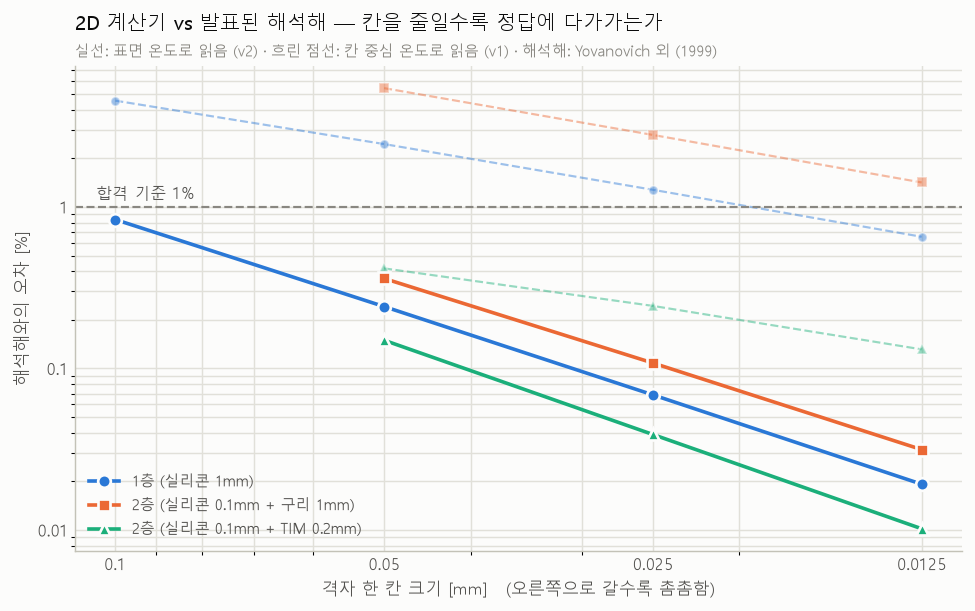

답이 수식으로 알려진 단순한 문제(Yovanovich 외 1999, 띠 열원·층 구조·대류 냉각)에 같은 계산기를 돌려 비교했다.

- 실제 쓰는 0.025 mm 격자에서 **0.11% 이내** 일치 (1층·2층 구조). 더 촘촘한 0.0125 mm 격자에서는 0.03% 이내
- 첫 시도(v1)는 2층 구조에서 **불합격**했다(−1.42%). 오차가 칸 크기에 비례하는 것을 보고 "온도를 표면이 아니라 칸 중심에서 읽었다"는 원인을 추정했다. 고친 뒤의 결과를 **실행 전에 예측해 적어 두었고**, 실제 결과가 예측과 ±0.002% 이내로 맞았다
- 자체 검사 9/9: 에너지 보존(넣은 열 = 나간 열), 고르게 발열하면 1D 공식과 소수점 4자리까지 일치 등

### AI는 맞는가 — 처음 보는 조건 160개

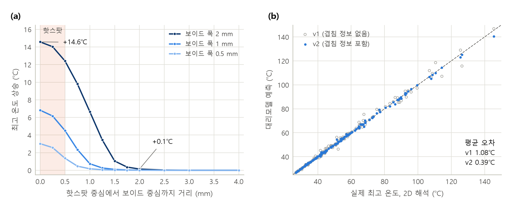
*(a) 빈틈 위치에 따른 온도 상승. (b) 처음 보는 조건 160개에서 AI 예측(세로)과 정밀 계산(가로). 점이 대각선에 붙을수록 정확하다.*

| 새 조건 160건 (시드 20261027) | 평균 오차 | 최대 오차 | 95% 범위 적중 |
|---|---:|---:|---:|
| v1 (겹침 정보 없음) | 1.08℃ | 10.70℃ | 93.8% |
| **v2 (겹침 정보 포함)** | **0.39℃** | **4.97℃** | **91.2%** |

- **밝혀 둘 점**: v2의 아이디어(겹침 정보)는 원래 채점 데이터의 오차를 분석한 **뒤에** 나왔다. 그래서 원래 채점 점수(0.30℃)는 쓰지 않는다. 대신 **한 번도 본 적 없는 조건 160건을 새로 계산**하고, 합격 기준(평균 오차 0.45℃ 이하 등 3개)을 미리 적은 뒤 다시 채점했다. 3/3 합격
- 어려운 곳에서 더 틀린다: 빈틈이 가장 뜨거운 곳을 덮는 68건은 평균 0.66℃, 나머지 92건은 0.19℃

### 공식을 깔면 데이터가 얼마나 줄어드나 — 학습 곡선

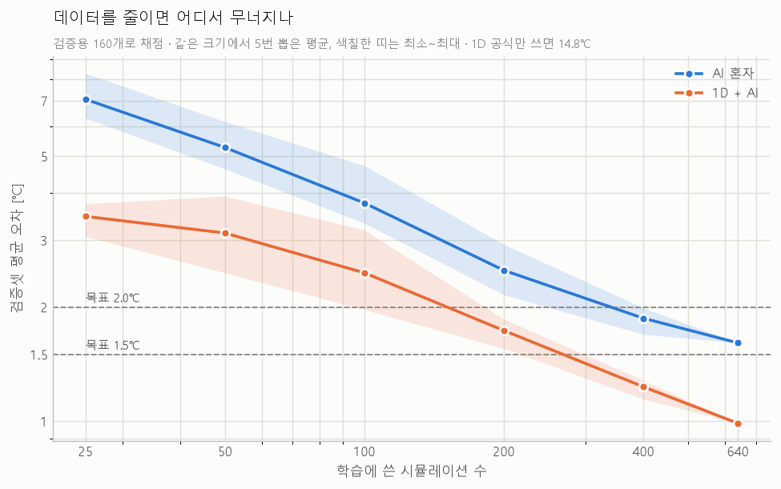

| 학습 데이터 수 | 25 | 50 | 100 | 200 | 400 | 640 |
|---|---:|---:|---:|---:|---:|---:|
| AI 혼자 | 7.07℃ | 5.27℃ | 3.76℃ | 2.50℃ | 1.87℃ | 1.61℃ |
| 1D 공식 + AI | 3.47℃ | 3.14℃ | 2.46℃ | 1.74℃ | 1.23℃ | 0.99℃ |

- 평균 오차 2℃ 안에 들어오는 데 **AI 혼자 400건, 공식 + AI 200건** → 정밀 계산이 **절반**이면 된다
- 공식 + AI는 25건만으로 AI 혼자 100건보다 정확했다
- (초기 모델 v1 기준 결과)

### 기능별 검증 요약

| 무엇 | 결과 |
|---|---|
| 웹 도구 계산부 자동 검사 | 12/12 (예측 0.001초, 위험 지도 0.3초, 범위 밖 입력 6종 거절 등) |
| 위험 지도 30칸을 정밀 계산과 비교 | 95% 범위 적중 93% (28/30) |
| 허용 보이드 답을 정밀 계산으로 확인 | 17/17 모두 온도 한계 이하 |
| 온도를 낮추려면 (30개 조건) | 1등 추천 일치 28/30, 변화량 오차 0.15℃ |
| 규격 vs 실제 (무작위 칸 확인) | 놓친 위험 10/10, 괜한 불량 10/10 |
| LLM 명령 · 질문 | 10/10 · 20/20, 지어낸 숫자 0개 |
| 화면 동작 검사 (브라우저 없이 자동) | 40/40 |

---

## 6. 이미 있는 연구와 무엇이 다른가

조사 기록과 확인 수준: [`docs/literature-review.md`](docs/literature-review.md)

**이미 알려진 것 (새 발견이라고 주장하지 않는다)**
- 빈틈은 열원 가까이 있을수록 열저항을 크게 올린다 — Fleischer 외, Otiaba 외(2012) 등 2000년대부터
- 빈틈을 위치별로 등급 매기는 보정 계수 — Ottinger 외(2022, 자동차 전력 모듈)
- X선 사진에서 빈틈 위치·크기를 뽑아 GPR로 열저항 예측, "빈틈 비율만으로는 부족하다" — Alavi 외(2024, *Electronics* 13(11) 2188). 이 프로젝트의 v2 결과와 같은 방향이다
- "싼 모델 + 비싼 시뮬레이션 조금"으로 데이터를 줄이는 방법 — 칩 열 해석(T-Fusion 2025)과 패키지 휨(박성환 외 2024)에 이미 있다
- 업계 검사 규격은 대부분 빈틈 **면적** 기준이다 — MIL-STD-883G Method 2012.7은 접촉 면적의 절반 초과, 또는 소자를 가로지르며 10%를 넘는 단일 보이드를 불합격으로 본다

**이 프로젝트에서 다른 점**
1. TIM 층의 빈틈과 **가장 뜨거운 곳의 상대 위치**(겹침)를 AI 입력으로 직접 만든 것
2. 계산 비용이 0인 **1D 공식을 기준선으로 결합**해 필요한 정밀 계산 수를 절반으로 줄인 것
3. **미리 적은 기준으로, 처음 보는 데이터 160건**에서 따로 채점한 것
4. 이것을 0.3초짜리 웹 도구로 만들어 규격 판정과 비교해 볼 수 있게 한 것

---

## 7. 한계

- **2D 단면 계산이다.** 가장 뜨거운 곳과 빈틈이 화면 안쪽으로 10 mm 이어진 띠가 되므로, 실제 3D보다 영향이 크게 나올 것으로 추정한다 (상한값으로 봐야 한다)
- **실제 반도체 칩으로 측정해 비교하지 않았다.** 외부 검증은 해석해가 있는 2층 구조까지이고, 3층 전체는 직접 검증하지 못했다
- 정상 상태(온도가 더 변하지 않는 상태)만 계산했다. 재료 성질은 온도와 무관하다고 가정했다
- 바닥(기판) 쪽 열 경로는 막았고(단열), 방열판과 뚜껑–방열판 사이 페이스트는 저항 하나(1 K/W)로 묶었다
- AI는 **이 2D 계산을 흉내 내는 것**이지 실제 반도체 칩 온도를 예측하는 것이 아니다. 2D 모델의 한계를 그대로 물려받는다
- 학습 범위 밖(예: 페이스트 0.5 mm, 방열판 5 K/W)은 예측하지 않는다
- 규격 vs 실제의 규격 판정은 다이 접합용 규칙을 TIM에 **비유로** 적용한 것이다
- LLM 채점 질문 20개와 명령 10개는 직접 만든 문장이다
- 학습 곡선은 데이터 크기 6단계만 봤다. "200건 vs 400건"은 그 사이 어딘가라는 뜻이다

---

## 8. 직접 실행하기

Python 3.11. 필요한 패키지는 [`requirements.txt`](requirements.txt) (numpy, streamlit, plotly, openai, python-dotenv). scipy는 쓰지 않는다.

```bash
pip install -r requirements.txt
streamlit run app/streamlit_app.py     # 웹 도구 (저장소 맨 위 폴더에서 실행)
```

**말로 조건 바꾸기(LLM)** 를 쓰려면 저장소 맨 위에 `.env` 파일을 만들고 OpenRouter 키를 넣는다. 키가 없으면 이 입력창만 꺼지고 나머지는 모두 동작한다.
`.env` 는 `.gitignore` 에 있어 GitHub에 올라가지 않는다.

```
OPENROUTER_API_KEY=여기에_키
```

검증 다시 돌리기

```bash
python scripts/thermal_2d.py            # 정밀 계산기 자체 검사 (9/9)
python scripts/validate_spreading.py    # 논문 해석해와 비교 (약 8분)
python app/validate_backend.py          # 웹 도구 계산부 검사 12항목 (약 2분)
python app/test_app.py                  # 화면 동작 검사 40항목
python app/fresh_test.py                # 새 조건 160건 계산 + 채점 (약 13분)
python app/spec_check.py                # 규격 vs 실제 무작위 확인
```

<details>
<summary>연구 단계별 스크립트 전체</summary>

```bash
python scripts/thermal_1d.py          # 1D 모델 + 자체 검증
python scripts/plot_2d.py             # 온도 분포 그림
python scripts/void_check.py          # TIM 보이드 효과
python scripts/sweep_void.py          # 보이드 데이터 800개 (약 40분, 중단 후 재실행 시 이어서)
python scripts/surrogate_void.py      # 대리모델 세 가지 비교 (약 2분)
python scripts/learning_curve.py      # 학습 곡선 (약 13분, --plot-only 로 그림만 재작도)
python app/train_v2.py                # v2 설정 고르기 + 원래 채점 데이터로 채점 (약 1분)
python app/nn_compare.py              # 딥러닝 비교
python app/sensitivity.py             # 민감도 분석 (순열 중요도)
python app/improve_check.py           # 온도를 낮추려면 검증
python app/eval_agent.py              # LLM 질문 20개 채점 (API 키 필요, 요금 발생)
python app/eval_command.py            # LLM 명령 10개 채점 (API 키 필요, 요금 발생)
python poster/build_poster.py && python poster/render.py   # A2 포스터
```

</details>

---

## 9. 폴더와 문서 안내

```
app/       웹 도구 (계산 model.py, 화면 streamlit_app.py, LLM agent.py, 검증 스크립트)
scripts/   1D·2D 계산기, 데이터 생성, 외부 검증, 그림
data/      계산 결과 (CSV, JSON, 실행 로그)
figures/   그림 (figures/readme/ 는 이 문서용 화면 캡처)
docs/      선행연구 조사, 검증 기록, 웹 도구 기획
poster/    A2 포스터 (poster.pdf)
```

| 문서 | 내용 |
|---|---|
| [`poster/poster.pdf`](poster/poster.pdf) | 비전공자용 A2 포스터 한 장 요약 |
| [`docs/validation-log.md`](docs/validation-log.md) | 모든 검증의 사전 등록 기준과 결과, 실패 기록 포함 |
| [`docs/literature-review.md`](docs/literature-review.md) | 선행연구 조사 (원문 확인 / 검색 요약 구분 표시) |
| [`docs/web-prd.md`](docs/web-prd.md) | 웹 도구 기획서 |
| [`CLAUDE.md`](CLAUDE.md) | 이 저장소에서 지키는 작업 규칙 |

---

## 10. 연구 과정 상세 기록

처음부터 웹 도구를 만든 것이 아니라, 계산기 → 검증 → 빈틈 측정 → AI → 웹 도구 순서로 진행했다. 단계별 원래 결과를 남긴다.

<details>
<summary>10.1 TIM 두께의 영향 — 1D 공식은 약 1/3로 과소평가</summary>

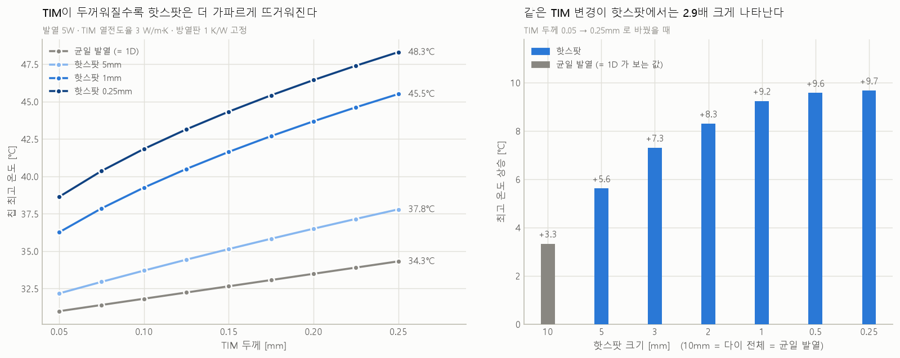

TIM 두께 9가지 × 핫스팟 크기 7가지 = 63회 계산 (`scripts/sweep_stage1.py`).
TIM 을 0.05 → 0.25 mm 로 두껍게 하면 최고 온도 상승이 균일 발열(= 1D)에서는 **+3.3℃**, 0.25 mm 핫스팟에서는 **+9.7℃** (**2.9배**).
→ 핫스팟이 있으면 1D 모델은 TIM 두께의 영향을 크게 과소평가한다.

2단계(`scripts/sweep_stage2.py`): TIM 두께·열전도율, 핫스팟 크기, 발열, 방열판 저항 5개를 무작위로 800개. 검증용 160개는 샘플링 시점에 미리 분리.

</details>

<details>
<summary>10.2 2D 계산기를 만들며 배운 것</summary>

- 재료 경계: 두 칸 사이를 반 칸씩 직렬로 보고 조화평균 열전도율 사용
- 경계: 윗면 방열판(대류), 바닥·옆면 단열
- 반복법: 체커보드 SOR. 수렴이 매우 느린 문제(내부는 잘 통하고 출구가 좁음)를 **1D 해를 초기값**으로 쓰고 **매 스윕 전역 레벨 보정**을 넣어 해결
- 수렴 판정은 "값의 변화량"이 아니라 "열 균형 잔차"로 한다 (변화량이 작아도 정답에서 5℃ 떨어져 있던 경우를 실제로 겪음)
- 1D 해에서 출발하면 "1D와 일치" 검사는 공짜로 통과한다 → 무작위로 흐트러뜨린 출발점에서도 같은 답으로 돌아오는지 확인

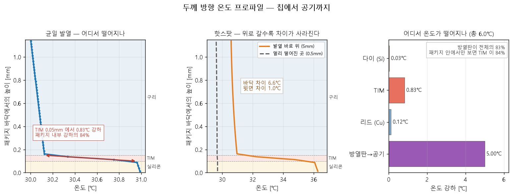

외부 검증 표 (가장 촘촘한 격자 0.0125 mm 기준. 합격 기준: 1% 이내 + 격자를 줄일수록 오차 감소)

| 조건 | v1 (칸 중심 온도) | v2 (표면 온도) |
|---|---:|---:|
| 1층 (실리콘) | −0.65% 합격 | **+0.019%** 합격 |
| 2층 (실리콘 + 구리) | −1.42% **불합격** | **+0.031%** 합격 |
| 2층 (실리콘 + TIM) | −0.13% 합격 | **+0.010%** 합격 |

실제 데이터를 만든 0.025 mm 격자에서는 v2 기준 0.11% 이내다. 스윕 1·2단계 데이터는 수정 전 방식(칸 중심 온도)으로 계산돼 확산 저항이 약 1.3~2.8% 작게 나왔다. 보이드 데이터부터 표면 온도를 쓴다.

</details>

<details>
<summary>10.3 AI 대리모델 1차 (v1) — 공식 + AI 와 AI 혼자 비교</summary>

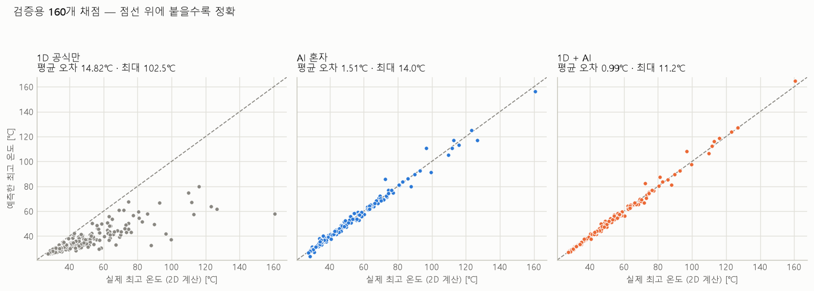

보이드 데이터 800개(학습 640 / 검증 160, 보이드 있음 627 / 없음 173). 설정은 학습 데이터 안의 5겹 교차검증으로만 고르고, 검증 160개는 마지막에 한 번만 채점에 썼다.

| 방법 | 평균 오차 | 최대 오차 |
|---|---:|---:|
| 1D 공식만 (AI 없음) | 14.8℃ | 102.5℃ |
| AI 혼자 (조건 7개 → 온도) | 1.5℃ | 14.0℃ |
| **1D + AI** (AI 는 1W 당 추가 온도만 학습) | **1.0℃** | **11.2℃** |

1D 공식만 쓰면 항상 낮게 예측한다(치우침 −14.8℃). 핫스팟과 보이드를 볼 수 없기 때문이다.

기록해 둘 것
- 대리모델 1차 실행에서 고른 설정값이 후보 범위의 끝이었다. 그래서 학습 곡선 실험에서는 범위를 넓혔다. 검증셋 채점 결과를 본 뒤에 바꾼 것이므로 여기에 남긴다
- 학습 곡선은 크기마다 검증셋을 반복해서 채점한다. 설정을 고르는 데는 쓰지 않았고 점수를 읽는 데만 썼다

</details>

<details>
<summary>10.4 오차는 어디에 몰려 있었나 → v2 의 출발점</summary>

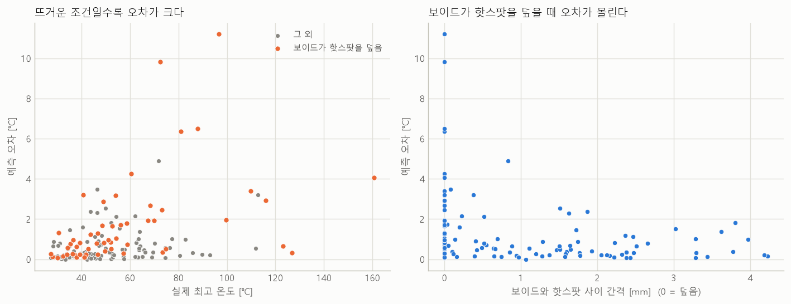

| 조건 (v1, 원래 검증 160건) | 건수 | 평균 오차 | 최대 오차 |
|---|---:|---:|---:|
| 보이드 없음 | 32 | **0.15℃** | 0.58℃ |
| 보이드가 핫스팟을 덮음 | 54 | **1.74℃** | **11.21℃** |
| 가까움 (간격 0~1mm) | 27 | 1.07℃ | 4.90℃ |
| 멀리 (간격 1mm 초과) | 47 | 0.64℃ | 2.53℃ |

웹 도구 검증(위험 지도 30칸을 실제 해석과 비교)에서도 v1 은 30칸 중 17칸만 95% 범위에 들었다.
핫스팟 바로 위는 3~4℃ 낮게, 핫스팟 가장자리의 큰 보이드는 3~4℃ 높게 예측했다.
v1 은 보이드의 폭과 '핫스팟 중심과의 거리'만 알아서, 보이드가 핫스팟에 닿는 순간 온도가 꺾여 오르는 것을 매끄럽게 뭉갰다.

v2 는 **보이드가 핫스팟을 얼마나 덮는지**(덮인 비율, 겹친 길이, 떨어진 거리)를 추가했다.

| | 교차검증 평균 오차 | 원래 검증 평균 오차 | 최대 오차 | 핫스팟 덮음 평균 | 위험 지도 적중 | 웹 검증 |
|---|---|---|---|---|---|---|
| v1 | 1.09℃ | 0.99℃ | 11.2℃ | 1.74℃ | 57% | 11/12 |
| **v2** | **0.35℃** | **0.30℃** | **7.6℃** | **0.66℃** | **93%** | **12/12** |

이 착안이 원래 검증셋의 오차 분석 뒤에 나왔으므로, v2 성능은 새 데이터 160건 기준 **0.39℃** 로 말한다 (5절).

</details>

---

코드 작성과 분석에 AI 코딩 도구(Claude Code)를 함께 사용했다.
